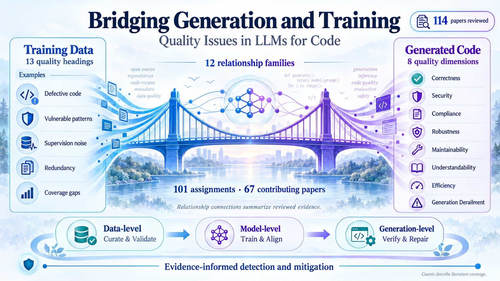
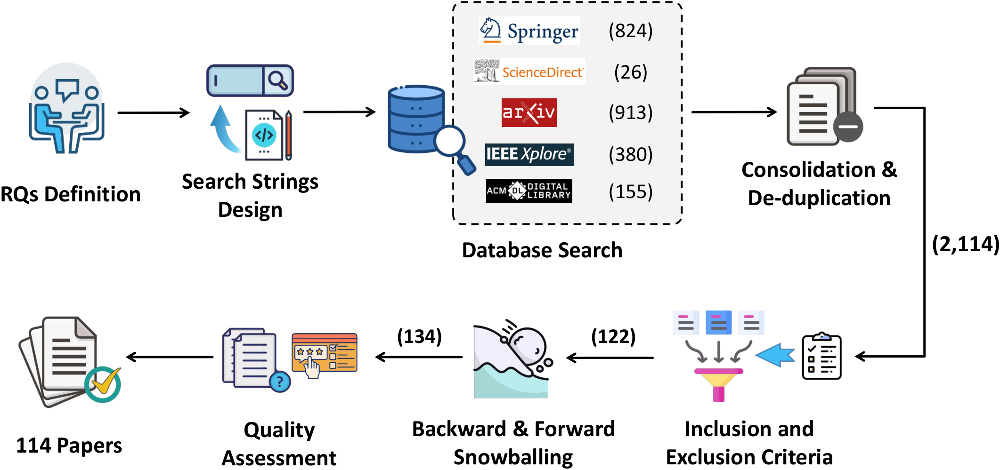
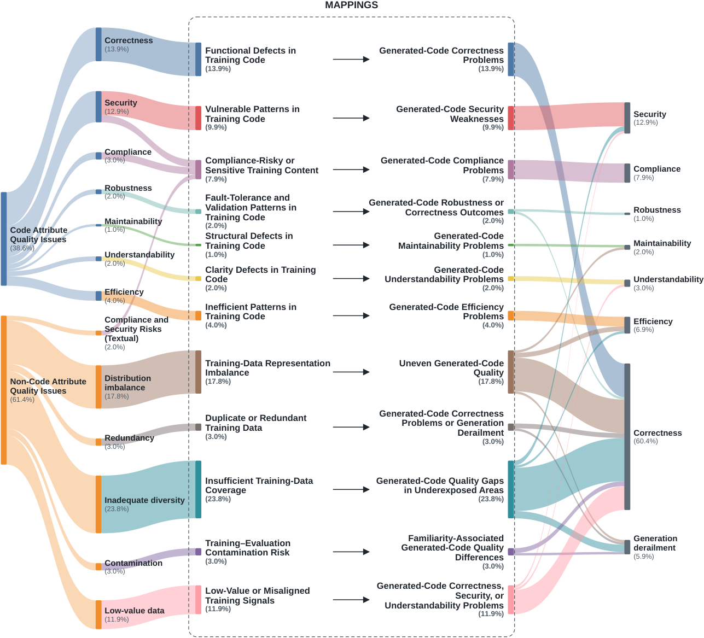

<h1 align="center">From Data to Code</h1>
<p align="center"><strong>Bridging Generation and Training: A Systematic Review of Quality Issues in LLMs for Code</strong></p>
<p align="center"><a href="https://SYSUSELab.github.io/From-Data-to-Code/">Project Website</a> · <a href="https://arxiv.org/abs/2605.05267">Original Preprint</a> · <a href="data/README.md">Data and Reproducibility</a></p>
<p align="center"><strong>114</strong> included papers · <strong>8</strong> generated-code dimensions · <strong>13</strong> training-data headings · <strong>12</strong> relationship families</p>



## Overview

This repository accompanies **“Bridging Generation and Training: A Systematic Review of Quality Issues in LLMs for Code.”** It connects taxonomies of training-data and generated-code quality with reported relationships, detection methods, and mitigation strategies across the LLM lifecycle.

Training-data quality is one contributor to generated-code outcomes alongside architecture, optimization and alignment, prompting and inference context, and decoding. The synthesis distinguishes controlled interventions, corpus audits, output comparisons, secondary syntheses, and authors' interpretations.

The documentation and result package reflect the major-revision synthesis. The [May 2026 preprint](https://arxiv.org/abs/2605.05267) and [archived PDF](paper/From-Data-to-Code.pdf) record the original version and have different taxonomy and mapping counts.

## Findings

| Question | Result | Evidence |
|:---|:---|:---|
| RQ1: Generated-code quality | Correctness, Security, Compliance, Robustness, Maintainability, Understandability, Efficiency, Generation Derailment | [195 paper–dimension memberships](data/rq1_code_quality.csv) |
| RQ2: Training-data quality | Seven code-attribute and six non-code/corpus headings | [165 paper–heading memberships](data/rq2_data_quality.csv) |
| RQ3: Data-to-code relationships | 12 recurring families; 101 assignments from 67 papers | [Definitions and evidence guide](data/rq3/README.md) |
| RQ4: Detection | Execution, static and corpus audits, model evaluation, learned scorers, and human review | [Detection guide](https://SYSUSELab.github.io/From-Data-to-Code/detection.html) |
| RQ5: Mitigation | Data construction, model adaptation, generation controls, and repair | [Mitigation guide](https://SYSUSELab.github.io/From-Data-to-Code/governance.html) |



Searches cover database publications through **December 31, 2025**. The 2,298 retrieved records became 2,114 unique records, then 122 eligible papers. Snowballing completed in February 2026 added 12 candidates. Quality assessment retained 114 of 134 candidates at a consensus threshold of 10/16. Independent pre-consensus totals from three reviewers yield interval Krippendorff's **alpha = 0.717**.

## Data-to-code relationships



One assignment is a unique **(paper, family, RQ2 source, RQ1 outcome)** combination. Repeated supporting passages count once. The 101 assignments connect to 105 used evidence records through 107 normalized links. Sankey widths indicate literature coverage; they do not estimate causal strength, effect size, or defect prevalence.

| Relationship family | Assignments | Share |
|:---|---:|---:|
| Defect-Pattern Carryover | 14 | 13.86% |
| Vulnerability-Pattern Carryover | 10 | 9.90% |
| Restricted/Sensitive-Content Reproduction Risks | 8 | 7.92% |
| Structural-Quality Associations | 1 | 0.99% |
| Clarity-Pattern Associations | 2 | 1.98% |
| Efficiency-Pattern Carryover | 4 | 3.96% |
| Supervision-Signal Quality Associations | 12 | 11.88% |
| Redundancy-Associated Reinforcement and Degeneration | 3 | 2.97% |
| Prevalence-Associated Quality Skew | 18 | 17.82% |
| Underexposure-Associated Quality Gaps | 24 | 23.76% |
| Contamination-Associated Familiarity Differences | 3 | 2.97% |
| Robustness-Pattern Associations | 2 | 1.98% |

Shares are independently rounded and sum to 99.99%. [Explore the interactive graph](https://SYSUSELab.github.io/From-Data-to-Code/figures/rq3/sankey.html), [download the manuscript figure](images/sankey.pdf), or inspect the [assignment table](data/rq3/study_mapping_assignments.csv).

## Result package

The compact [data directory](data/README.md) contains final tables and the score inputs needed to verify the reported agreement statistic:

- The [114-paper register](data/included_studies.csv), [consensus totals](data/quality_scores_for_included_papers.csv), and [three independent totals for 134 candidates](data/rater_scores.csv).
- RQ1/RQ2 memberships and the [operational codebook](data/rq3/taxonomy_codebook.csv).
- Final RQ3 definitions, assignments, linked evidence, aggregate graph tables, and portable figure-generation scripts.
- [32 method leaves](data/method_taxonomy.csv), [249 paper–method memberships](data/method_assignments.csv), and the [21-row automation crosswalk](data/automation_examples.csv).
- [Publication-status and author-overlap sensitivity results](data/sensitivity/README.md), frozen at **August 29, 2026**.

The automation audit establishes that every broad code/data heading has at least one subtype-specific automated detection exemplar and at least one mitigation exemplar. These may address different subtypes; the audit does not establish exhaustive coverage or production readiness.

## Reproduce and inspect

Python 3.10+ is sufficient to validate the data and generate the interactive SVG/HTML graph:

```bash
python3 scripts/validate_release.py
python3 scripts/render_sankey.py --no-static-export
python3 scripts/render_sankey_panels.py --no-static-export
```

The main renderer writes `figures/rq3/sankey.html` and `.svg`. The manuscript-style panel renderer writes to the Git-ignored `.local/rq3-panels/` directory. Optional PNG/PDF export requires `playwright==1.64.0` and its Chromium bundle. See [scripts/README.md](scripts/README.md).

Check repository paths, text, and PDF text for Chinese characters:

```bash
python3 -m pip install pymupdf==1.28.2
python3 scripts/check_english.py
```

The check reports raster images for visual review. Taxonomy and method diagrams have searchable SVG sources; the collection, lifecycle, and manuscript Sankey images are rendered from the revision's PDF figures. The homepage uses matching light/dark PNG illustrations described in [images/README.md](images/README.md).

Build the GitHub Pages site locally with Ruby and Bundler:

```bash
bundle install
bundle exec jekyll serve
```

The [validation report](data/validation_report.md), [data checksums](data/checksums.json), and [source provenance](data/provenance.json) support review. No private reviewer correspondence, raw database exports, full-text paper collection, candidate mappings, or batch working files are part of this package.

## Contributing

When proposing a correction or additional paper, identify the research question, primary source, supporting passage, and scope limitation. Keep counts and figure inputs consistent and run the release checks before submitting a pull request.
